# Shinobi (PS2) Recomp

**v0.7.0 is out:** Save states with 3 slots, a Field of View slider, no camera recentering, a proper PC mouse and keyboard layout, a final boss health slider, restart with Ctrl+R, an on-screen shortcuts panel (H), the Retry sound bug fixed, 13 fixes in all and lighter on the CPU. **[Download v0.7.0](https://github.com/TheRealAfsan/Shinobi-PS2-Recomp/releases/latest)** · **[HD Texture Pack v2](https://github.com/TheRealAfsan/Shinobi-PS2-HD-Texture-Pack-1/releases/latest)** (optional: 372 textures, now with Stage 2) · [What's new](https://github.com/TheRealAfsan/Shinobi-PS2-Recomp/releases/tag/v0.7.0)

**v0.6.0:** Languages (Japanese, French, German, Italian, Spanish), a Jukebox for all 30 music tracks, IMAX story movies, true 1:1 mouse aiming, a rebuilt launcher and half the download (67 MB to 35 MB). **[Download v0.6.0](https://github.com/TheRealAfsan/Shinobi-PS2-Recomp/releases/latest)** · **[HD Texture Pack 1](https://github.com/TheRealAfsan/Shinobi-PS2-HD-Texture-Pack-1/releases/latest)** (optional: 235 textures, the HUD, menus and Stage 1, growing every update) · [What's new](https://github.com/TheRealAfsan/Shinobi-PS2-Recomp/releases/tag/v0.6.0)

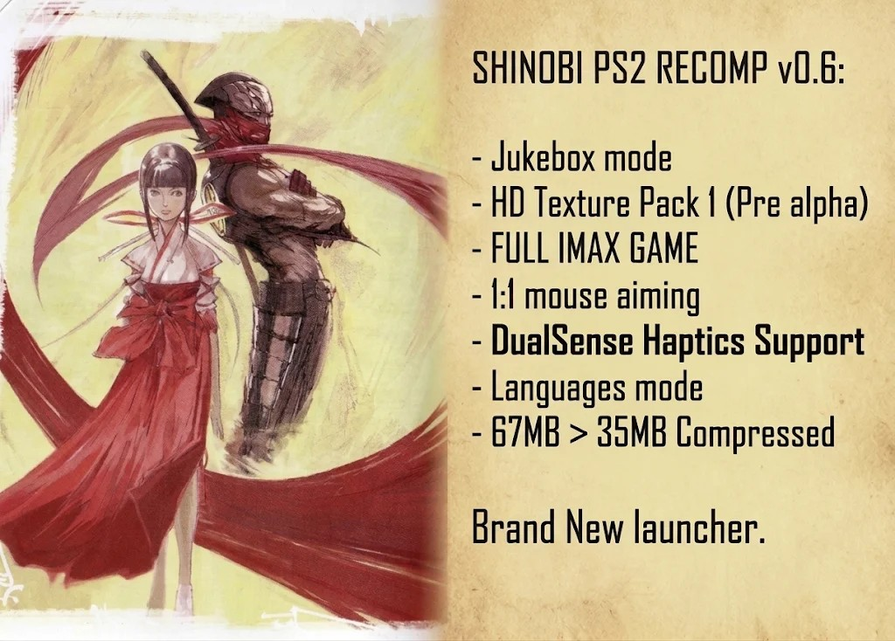 Shinobi PS2 Recomp v0.6.

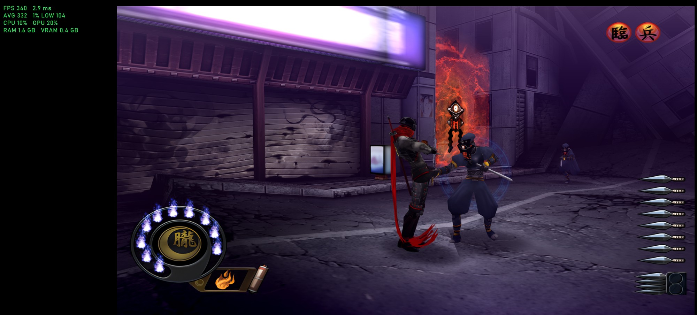 Stage 1 with HD Texture Pack 1: the HD HUD, at 340 FPS with frame generation.

**v0.5.3:** Runs on older CPUs too (no AVX2 needed), HD texture packs you can switch live with **Shift+F5**, and a download 40% smaller (111 MB to 67 MB) with nothing taken out. The HD HUD is a work in progress: more of it gets upscaled with every update. [More below](#v053-hd-textures-older-cpus-and-a-smaller-download).

**v0.5 is out:** Frame Generation (360 FPS+), Latency Reduction, IMAX Mode, a Final Boss Balance mode, Infinite Health, 8 new mods on the F keys, Proton / Linux / Steam Deck (beta), a new overlay and 15+ fixes. 🔥

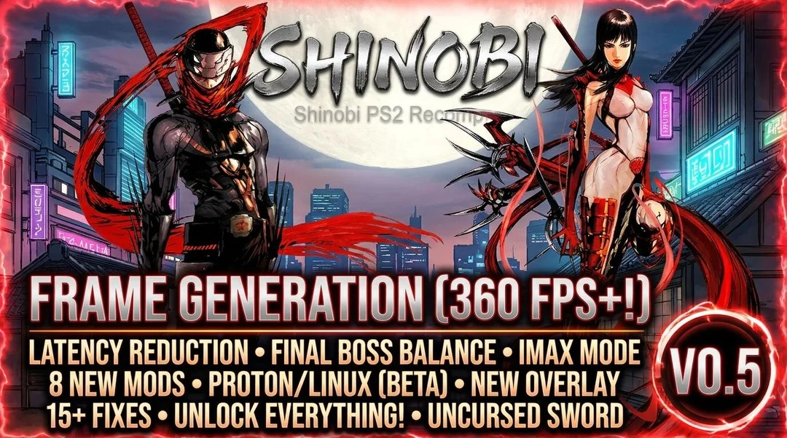

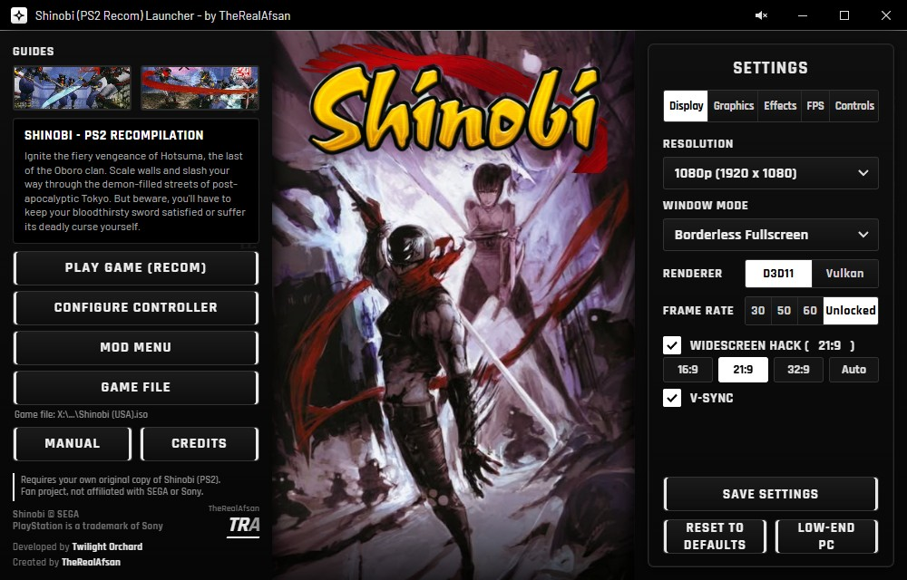
 The new dark launcher. The art stays in full colour.

## Download and play

**Easiest: [RecompLauncher](https://recompstore.com/dev/therealafsan).** It installs the game and keeps it up to date for you (new versions appear there once they are verified, usually within a few hours to a day).

**Or from GitHub:**

1. Open **[Releases](https://github.com/TheRealAfsan/Shinobi-PS2-Recomp/releases)** and download the newest **Shinobi-PS2-Recomp-v…-Windows-x64.zip** (30 MB). Right-click it and choose **Extract All...** (any folder except Program Files).
2. Run **`Shinobi Launcher.exe`** (it is in the main folder you just unzipped).
3. Press **Game File**, choose your own Shinobi (USA) disc image, press **Set up game files**, then **Play Game**.

Coming from v0.4? Download the newest release once and unzip it over your old folder (your saves, settings and game files are kept). From v0.5 on, the launcher updates itself: when a new version is out, an **Update** button appears in its title bar.

Everything is in this one repository: the launcher, the game program and the source code.

> ### You must own the game
> Buy your own copy of **Shinobi (PlayStation 2, USA)** and make a disc image (`.iso`) from your own disc with a DVD drive and a disc-imaging tool. **This repository contains no game, no disc image and no game data**, and it never will. We do not provide, link to or help anyone find a copy of the game. No disc, no game.

---

A native Windows port of **Shinobi** (PlayStation 2, USA) by **TheRealAfsan**, [Twilight Orchard](https://www.youtube.com/@TheReal_Afsan).

YouTube: <https://www.youtube.com/@TheReal_Afsan>  
Reddit: <https://www.reddit.com/user/Afsan23/>

> **This repository does not contain the game.** No disc image, no game files and no game data. You need your own copy of Shinobi (PS2, USA, SLUS-20459), made into an image file from the disc you own.

The game's own program is translated ("recompiled") to run natively on Windows. PCSX2's graphics (GS) and sound (SPU2) code is used for the parts that have to match the PS2 exactly.

---

## v0.6: languages, jukebox, IMAX movies, 1:1 mouse aiming and a rebuilt launcher

Everything in detail is in the [v0.6.0 release notes](https://github.com/TheRealAfsan/Shinobi-PS2-Recomp/releases/tag/v0.6.0). The highlights:

### HD Texture Pack 1 (pre-alpha, separate download)

235 textures upscaled 4x on the GPU, with the PS2's transparency handled properly: the whole HUD, every menu, the font, the title cards and Stage 1. **[Download it here](https://github.com/TheRealAfsan/Shinobi-PS2-HD-Texture-Pack-1/releases/latest)**, unzip it into the game folder, and press **Shift+F5** in game to compare. It grows with every update.

<table><tr><td width="50%" align="center">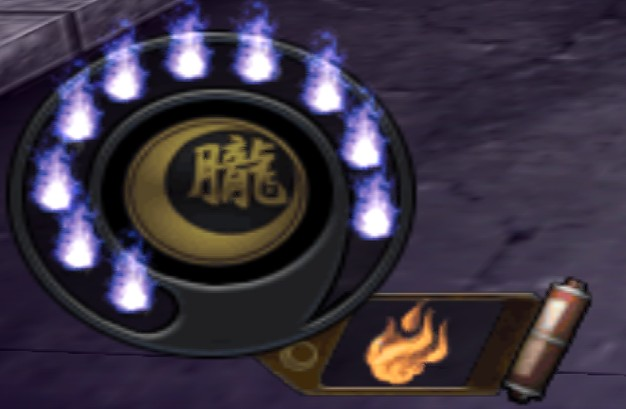 Original HUD</td><td width="50%" align="center">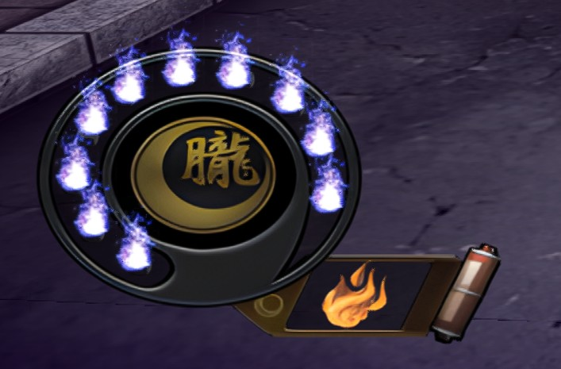 HD Texture Pack 1</td></tr></table>

<table><tr><td width="50%" align="center">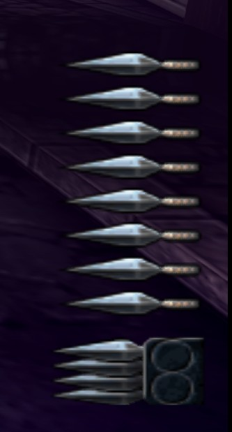 Original kunai counter</td><td width="50%" align="center">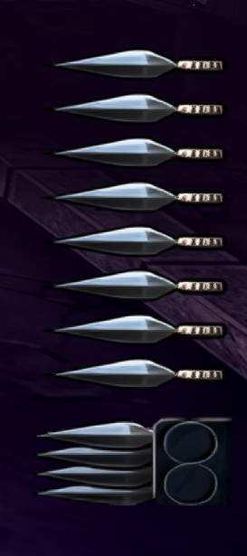 HD Texture Pack 1</td></tr></table>

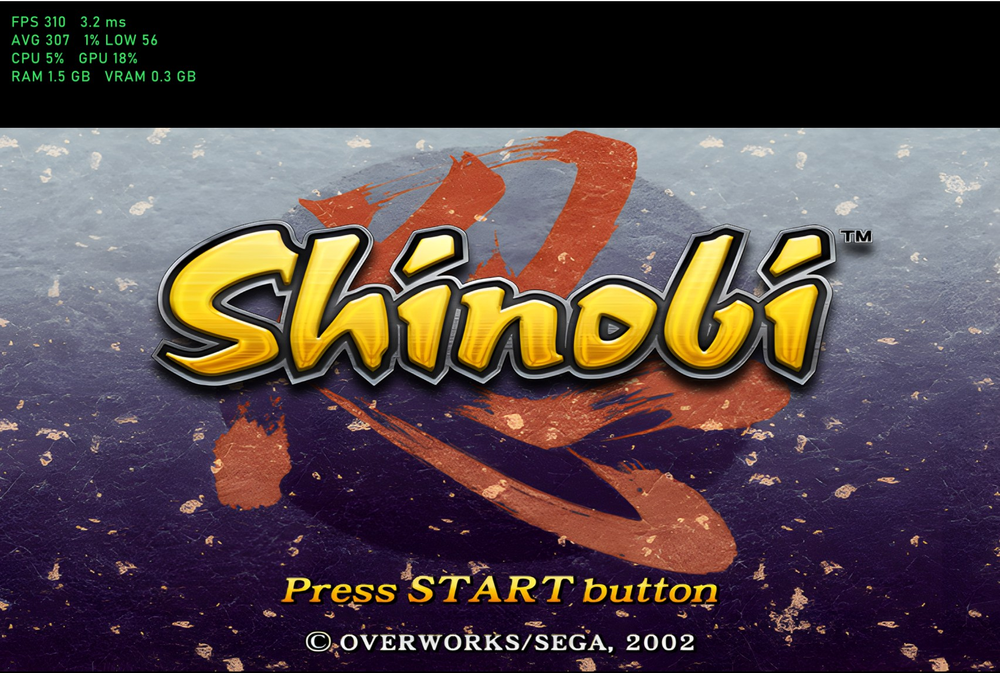 The title screen with HD Texture Pack 1.

### IMAX movies

IMAX mode (**F7**) now covers the pre-rendered story movies: full screen, edge to edge, subtitles laid over the picture. (The in-game story scenes are next.)

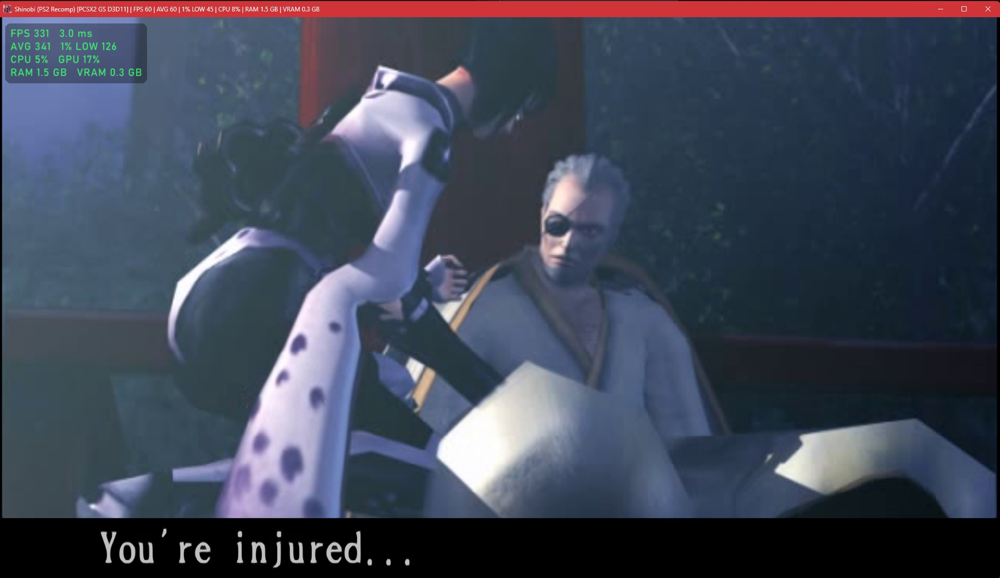 A story movie in IMAX mode: no bars on any side.

### Languages, Jukebox and sound

Japanese voices and text straight from your US disc; French, German, Italian and Spanish from your own Shinobi (Europe) disc image, read live and never copied. Replace any of the 30 music tracks with your own files. A new Game Volume slider.

<table><tr><td width="50%" align="center">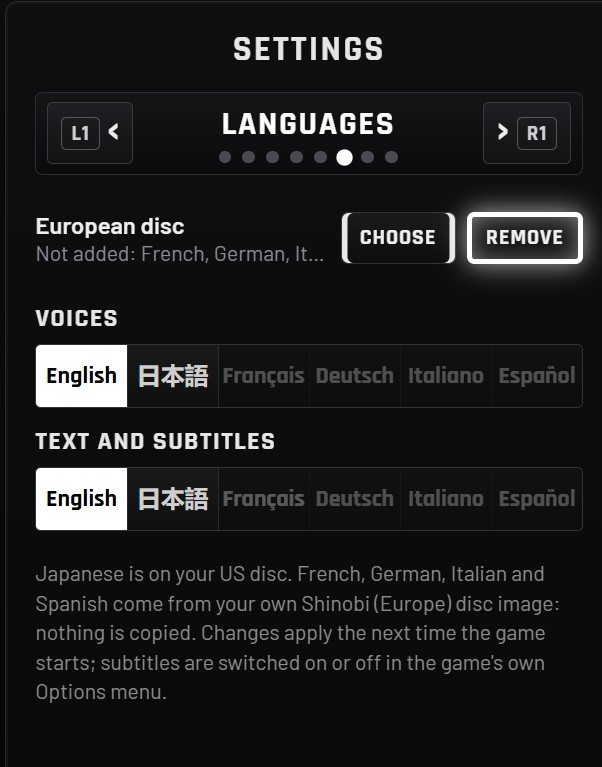 Languages: voices and text chosen separately.</td><td width="50%" align="center">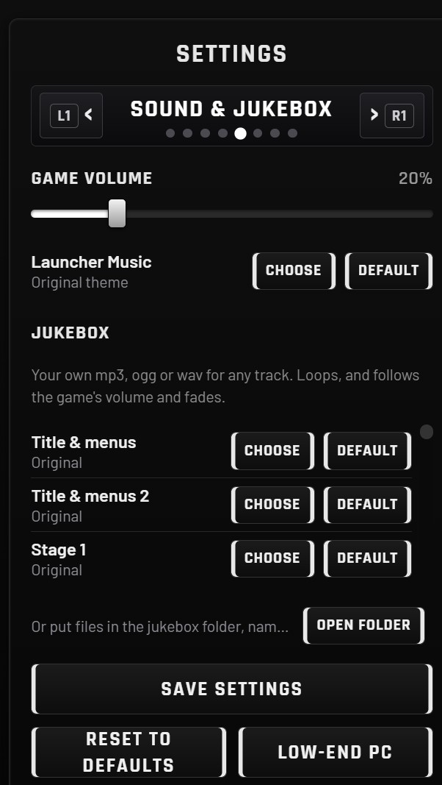 Sound & Jukebox: Game Volume, launcher music and all 30 tracks.</td></tr></table>

### Controls

True 1:1 mouse aiming, WASD, Shift / Ctrl / Alt binds, controller detection with the right button names, DualSense menu haptics and haptics settings in the Mod Menu. Inverted camera now works with the mouse as well as the controller.

<table><tr><td width="50%" align="center">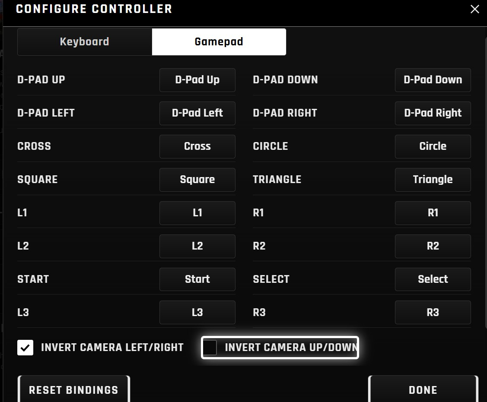 Invert camera left/right and up/down: now for the mouse too.</td><td width="50%" align="center">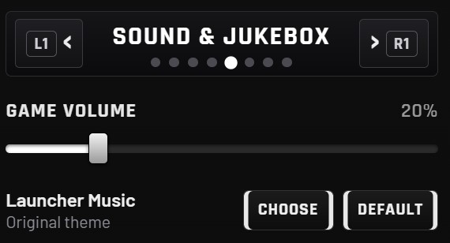 The new Game Volume slider.</td></tr></table>

### The launcher, rebuilt

Opens full screen (windowed), a new boot screen and theme, settings one page at a time (L1/R1), and a Feature Set page that shows everything the recomp does, the new features marked in gold, and your installed version.

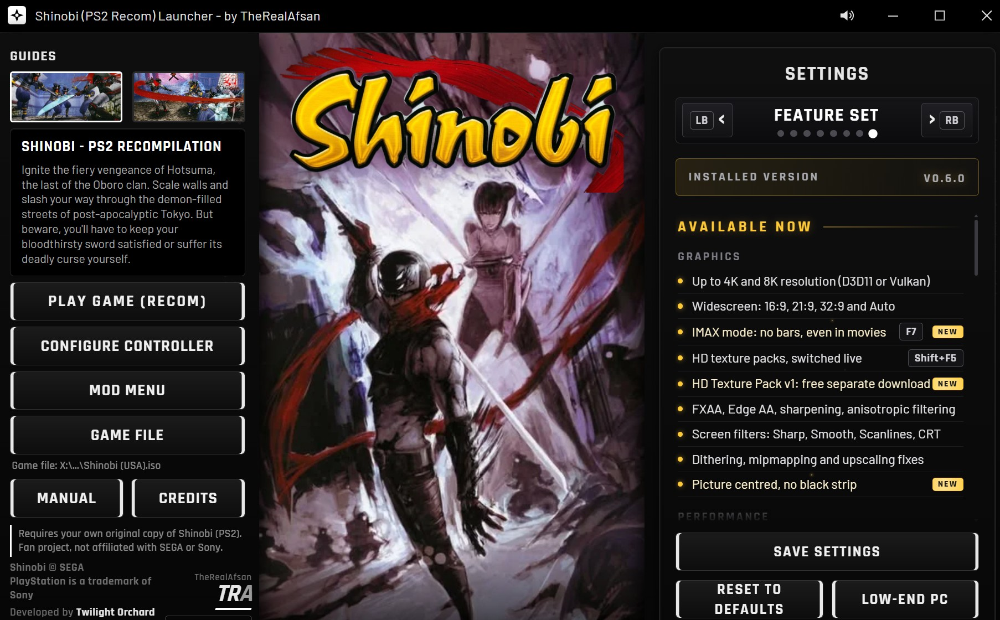 The rebuilt launcher, on the Feature Set page.

<table><tr><td width="50%" align="center">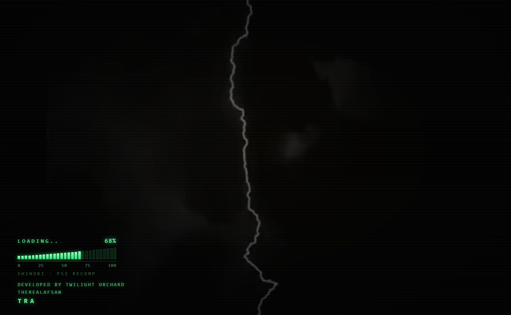 The new boot screen.</td><td width="50%" align="center">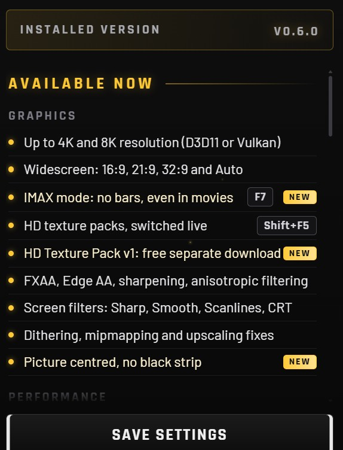 New features marked with gold sparks and a NEW tag.</td></tr></table>

### Half the download

67 MB to 35 MB: a video decoder built for this game alone (1 MB instead of 30 MB), the old-CPU build fetched only on the PCs that need it, unused emulator files removed, and the launcher's media re-compressed.

## v0.5.3: HD textures, older CPUs and a smaller download

### HD texture packs (Shift+F5) — the HD HUD is a work in progress

The game can now load higher-resolution versions of its own textures (PCSX2's texture replacement, built into the recomp's graphics code). **Shift+F5** switches them on and off while you play, so you can see the difference straight away.

We're upscaling the HUD a piece at a time, and more gets done with every update. Done so far:

- the health gauge (frame, the "9", its red veins and the blue soul flames)
- the magic scroll and its icons (fire, slash, lightning) and the counter digits
- the kunai icons
- the TATE kill orbs and their kanji
- the lock-on circle

Still to come: boss gauges, the remaining icons and the menus, as we get to them.

**Why the HD textures aren't in the download:** they're made from the game's own artwork, and this project never ships anything from the game. So you build them from your own copy, which takes a few minutes:

1. In the launcher's Mod Menu, switch on **Save textures (pack makers)**, play until the HUD is on screen, then switch it off again.
2. Upscale the saved HUD textures with [`scripts/ps2_upscale.py`](scripts/ps2_upscale.py) (Real-ESRGAN on your graphics card). It handles the PS2's transparency properly, so there are no fringes or halos.
3. The results go into `textures/SLUS-20459/replacements`, and the HUD is HD the next time it appears.

[`textures/README.txt`](textures/README.txt) has the details. Packs made for PCSX2 (Shinobi USA, SLUS-20459) work too.

### Runs on older CPUs

No more AVX2 requirement: any 64-bit processor with SSE4.1 (2008 or newer, the same minimum as PCSX2) runs the game. It's still one launcher and one download. The launcher picks the faster AVX2 version or the compatible one for your CPU by itself.

### 40% smaller download

111 MB down to 67 MB, with nothing the game uses taken out. The two game programs are packed together with 7-Zip's compression, and DLLs that nothing ever loaded were removed.

### Also

- The launcher's self-update now works under Proton / Linux / Steam Deck too, and downloads are more reliable.
- Fixed a crash on start-up when the game folder's name has certain characters (Japanese or accented letters).

---

## v0.5: frame generation, IMAX mode and a pile of mods

A lot of this came straight from your feedback on Reddit. Thank you.

### Performance

- **Frame Generation (F4):** in-between frames for high refresh rate screens. Targets: Auto, 120, 144, 240, 360 or Max. Auto sits just under your screen's refresh rate. (Expect some ghosting the higher you go.)
- **Latency Reduction (F6):** stops the graphics driver queueing frames, for about 16–33 ms less input delay (similar idea to NVIDIA Reflex).
- **New Performance Overlay (F2):** FPS, frame time, average, 1% lows, CPU, GPU, RAM and VRAM.

<table>
<tr>
<td width="62%">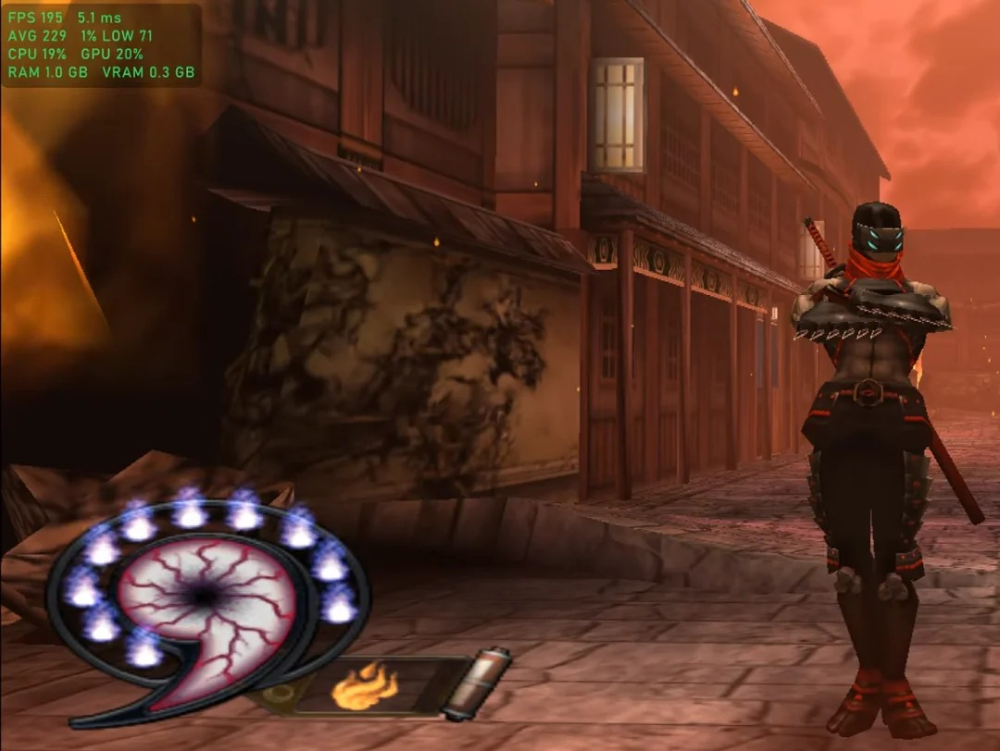 Frame generation with the overlay: around 200 FPS.</td>
<td width="38%">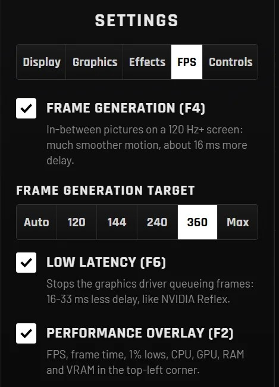 The new FPS tab.</td>
</tr>
</table>

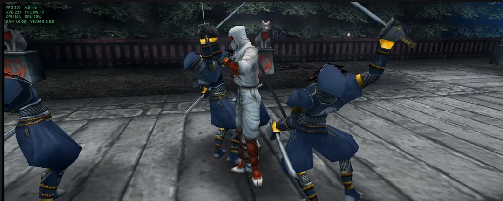
 Combat at 250 FPS.

### 8 new mods (Mod Menu, or straight from the F keys while you play)

- **IMAX Mode (F7):** the TATE finishing moves play full screen with no black bars. Movies and story scenes keep theirs. (This was the hardest part.)
- **Infinite Health (F8):** Hotsuma takes no damage from hits, and Akujiki can't drain him.
- **Final Boss Balance (F9)** *(beta)*: Hiruko without the hidden rules.
  - Seals open with one counted hit.
  - No parries of your sword before the real fight, and no instant guard when you slash him while he's idle.
  - He only teleports to spots on the ground, never mid-air.
  - Lock-on stays on him instead of jumping to the talismans.
  - You can hit him while he laughs and while he teleports.
  - Talismans that blow themselves up still count towards your TATE chain, and new ones come twice as fast.
- **Hide HUD (F5):** health, kunai, magic, TATE counter and boss gauges hidden for a clean screen.
- **Uncursed Sword (Shift+F7):** Akujiki no longer drains your health when you haven't killed for a while.
- **Unlock Everything (Shift+F6):** every difficulty, character and extra open from the start. Your save isn't changed. (Restart the game after switching it.)
- **Remove Scarf (Shift+F8):** Hotsuma without his scarf.
- **Scarf Body Collision (Shift+F9)** *(early)*: the scarf keeps its float and trail but no longer clips through Hotsuma.

<table>
<tr>
<td width="50%">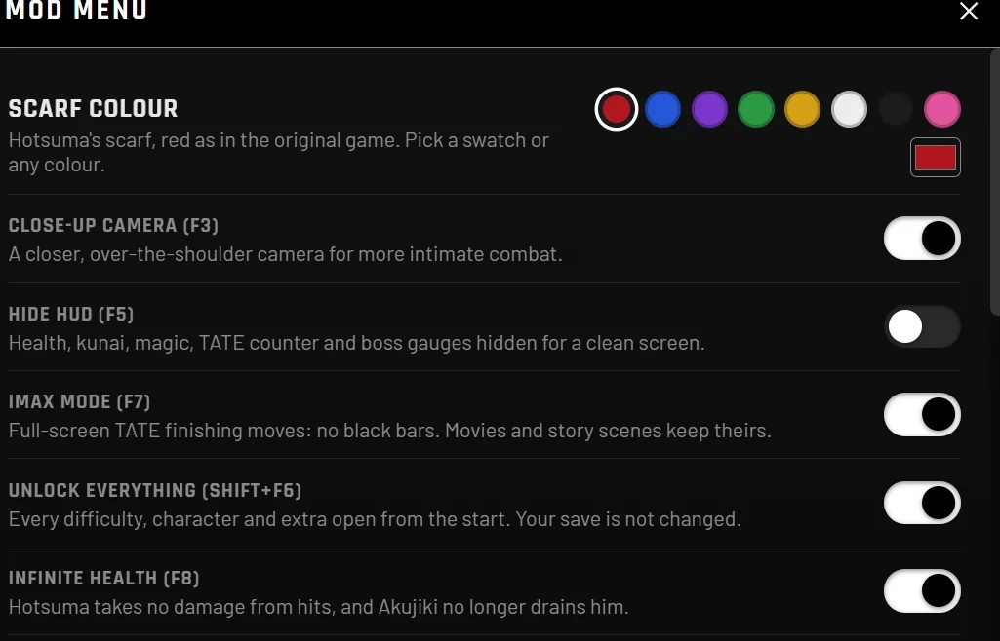</td>
<td width="50%">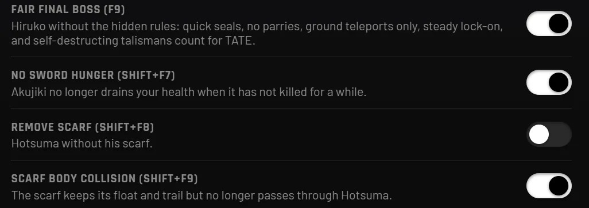</td>
</tr>
</table>

### Controls

- Full controller remapping.
- Invert camera (left/right and up/down separately).

### Movies

- The movie viewer now plays every movie cleanly, without the pink artifacts.

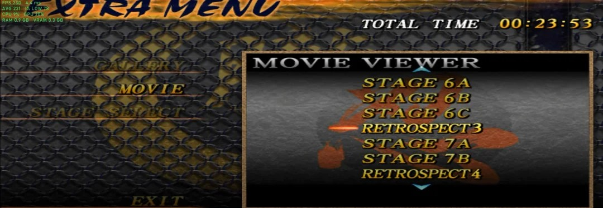

### Proton / Linux / Steam Deck (beta)

- The launcher now works under Proton. It skips its window, asks for your ISO once, copies the files and starts the game. After that it starts the game straight away.
- Fixed ISOs failing to load when started from RecompLauncher on Linux.
- The game now unpacks properly under Wine/Proton.
- This is beta: please report how it runs on your setup.

### 15+ fixes

- Pink boxes on the duo boss: fixed.
- Pink square when an enemy dies at 21:9: fixed.
- Missing textures in rushed cutscenes: fixed.
- Freeze when changing Screen Position: fixed.
- Freeze when switching to 4K while playing: fixed.
- Updating over an old folder kept the old game: fixed.
- Changing render scale in game now applies safely on restart.
- F1 menu in exclusive fullscreen left the window the wrong size: fixed.
- Launcher tabs could get squeezed off the bar: fixed.
- The launcher now also starts on Windows 10 PCs without WebView2.
- Hotkey notices and overlay text now use a proper font.
- Resolution labels show real sizes (1920 × 1080, 3840 × 2160…).
- The launcher can now update itself.

### New defaults

1440p, D3D11, 60 FPS, 16:9, V-Sync and FXAA on, Latency Reduction and the overlay on, IMAX Mode and Final Boss Balance on, SEGA logos skipped. Reset to Defaults in the launcher brings these back.

### Known issues

- 21:9 and wider are still experimental.
- 8K may not fill the whole screen, and HDR turns off at 8K (looking into it).

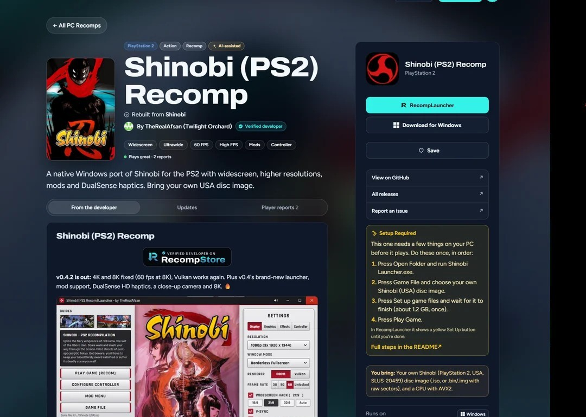
 Now on RecompLauncher.

---

## v0.4: the biggest update yet

> **v0.4.2: 4K and 8K fixed.** Every frame the full-size picture was copied back from the graphics card (165 MB a frame at 8K), so high resolutions ran at a few frames a second. The copy is now capped at your screen size and shrunk in steps that keep the extra detail, so 4K/8K look smoother too. 8K went from 21 to 60 fps on our test PC.
> - **Vulkan works again:** it could not find its shader compiler and silently fell back to the slow software renderer.
> - **Graphics cards with little video memory:** 4K/8K is lowered automatically instead of showing green/pink textures or a black screen.
> - The launcher marks 4K as "needs a strong GPU" and 8K as "experimental".
>
> **v0.4.1:** the game manual is no longer included in the download. Open your own Shinobi manual PDF with the launcher's Manual button: page-turning, zoom and F4 work the same.

v0.4 is here, as promised! Grab a drink.

### The big ones

1. **A brand-new launcher.** New rotating artwork, settings in tabs, a proper Shinobi icon, a resizable window that snaps 50/50, and you can drive the whole thing with a controller.
2. **Mod support.** Change Hotsuma's scarf to any colour you like, live, plus a new close-up camera mod, all switchable in game.
3. **Full DualSense HD haptics, wired AND wireless.** Every footstep left and right, every shuriken, every sword hit, and an L2 trigger that clicks before your magic fires.
4. **A close-up, over-the-shoulder camera (F3)** for more intimate combat. It glides in and glides back out.
5. **Read your own game manual in the launcher.** Open your Shinobi manual PDF once: real page-turning and zoom, and **F4** in game slides it up over the action.
6. **Performance overlay (F2):** FPS, frame time, 1% lows, CPU, GPU, RAM and VRAM, NVIDIA-style.
7. **Big performance work:** geometry now runs across multiple CPU cores, the sound chip is 30% cheaper, and there's a new Low-end PC preset.
8. **8K resolution** and a whole set of new graphics options.
9. **Change settings live in game with F1.** Most no longer need a restart.
10. **The missing cutscenes are fixed.**
11. **Recomp Store / RecompLauncher:** approved developer, with support coming soon (submission in progress).

 The new close-up camera (F3) and an orange scarf, picked live from the Mod Menu.

### Brand-new launcher

- New rotating artwork behind the logo, crossfading every few seconds.
- Settings in tabs: **Display, Graphics, Effects, Controller**.
- Fully playable with a controller:
  - D-pad or stick moves, ✕ picks, ○ goes back, L1/R1 switches tabs.
  - A clear red highlight shows where you are.
- The window resizes, maximises and snaps (50/50 with another window).
- Window Mode: Borderless, Exclusive Fullscreen or Windowed.
- Your own Shinobi manual (PDF), with page-flip animation, mouse-wheel zoom and controller page-turning.
- A Game File checklist plus an "I own this copy" tick, so you know your disc image is right.
- A proper Shinobi icon on the launcher and the game.
- It picks the right game build for your CPU (AVX2, or the SSE4.1 fallback for older processors).

<table>
<tr>
<td width="50%"> <b>Graphics:</b> texture quality, sharpening, anti-aliasing, blending accuracy, texture filtering.</td>
<td width="50%"> <b>Effects:</b> screen filter (Sharp / Smooth / Scanlines / CRT), dithering, mipmapping, upscaling fixes.</td>
</tr>
<tr>
<td width="50%"> <b>Controller:</b> DualSense haptics, haptic strength, L2 trigger resistance.</td>
<td width="50%"> <b>Mods:</b> Hotsuma in a blue scarf, picked live.</td>
</tr>
</table>

### Mod support

- **Scarf colour:** pick any colour for Hotsuma's scarf from a colour picker. It changes live while you play.
- **Close-up camera:** an over-the-shoulder view (below).
- Mods live in the Mod Menu and the F1 menu, so you can switch them on the fly.
- This is the foundation for more mods to come. Tell me what you want next 👀

<table>
<tr>
<td width="50%"> The Mod Menu with the scarf colour picker.</td>
<td width="50%"> Hotsuma in a blue scarf.</td>
</tr>
</table>

### DualSense HD haptics (DualSense and DualSense Edge)

I didn't want "rumble". I wanted it to feel like a modern PS5 game, so I built it from scratch, timed to the animations frame by frame.

- Walking is light left/right taps, and running is heavier.
- Each shuriken throw pushes on the side of the throwing hand.
- Sword swings are strong, and landing a hit is a heavy thud.
- The dash is a run of taps that travels across the controller.
- The ○○△ shuriken storm is an electric crackle the moment the shuriken leave his hands.
- **Ninja magic:** L2 stiffens, you push through the click, and the whole controller swells as it fires. No more wasting magic with a light touch.
- It works over **USB and Bluetooth**, with a strength slider and on/off switches in the launcher.

### Close-up camera (F3)

- Press **F3** and the camera pushes in behind Hotsuma's shoulder, easing in rather than teleporting. Press F3 again to ease back out.
- It steps aside automatically when you lock on with R1, so the two never fight.
- It's also a switch in the launcher.

### Performance

- Geometry runs across multiple CPU cores.
- The sound processor is about **30% cheaper** and stays steady in long sessions.
- New **Low-end PC** preset for slower machines.
- **Performance overlay on F2**, so you can see exactly where you stand.

### Graphics

- **8K** (12×) internal resolution.
- Most settings change in game with F1, no restart needed.
- New options:
  - Blending Accuracy
  - Texture Filtering
  - Screen Filter (Sharp / Smooth / Scanlines / CRT)
  - Dithering
  - Mipmapping
  - Upscaling Fixes

 The F1 menu over the game: change settings and mods live, then carry on playing.

### In game

| Key | |
|---|---|
| **F1** (or Select+Start) | Menu: settings, mods and controller, all live (pauses the game) |
| **F2** | Performance overlay |
| **Ctrl+F1** | Save state (save the game exactly where you are) |
| **Ctrl+F2** | Load state (back to where you saved) |
| **Ctrl+1 / 2 / 3** | Pick the save state slot |
| **Ctrl+R** twice | Restart the game |
| **H** | Shortcuts panel: every hotkey and mod, with its state |
| **F3** | Close-up camera |
| **F4** | Frame generation |
| **F5** | Hide HUD |
| **F6** | Low latency |
| **F7** | IMAX mode (no black bars in TATE finishing moves) |
| **F8** | Infinite health |
| **F9** | Fair final boss |
| **Shift+F6** | Unlock everything |
| **Shift+F7** | No sword hunger |
| **Shift+F8** | Remove scarf |
| **Shift+F9** | Scarf body collision |
| **Shift+F5** | HD textures on / off |
| **F10** | Mouse camera on / off |
| **Alt+Enter / F11** | Window or full screen |

Pressing any of these slides a little notice down in the corner, so you know it's on or off.

### Fixes

- The missing cutscenes are fixed.
- Controllers work even with Steam Input or other virtual pads connected.
- The F1 menu always responds to the controller.
- The game starts in fullscreen properly.
- Fixed a crash in ultrawide.

### Known issues

- The duo boss's projectiles still show pink boxes.
- The frame rate can dip in the heaviest fights on slower CPUs. Full multi-thread support is in, so there should be gains on lower-end CPUs too.
- Haptics are tested on the DualSense Edge; the standard DualSense should behave the same.
- In rare cases, a cutscene that is rushed while loading can show missing textures.

Any issues? Tell me in the Issues tab or on Reddit, I read everything and I'll fix it.

---

## What you need

- Windows 10 or 11, 64-bit
- Any 64-bit processor with SSE4.1 (Intel Core 2 from 2008, AMD from 2011, or newer: the same minimum as PCSX2). With AVX2 (Intel Core 4th generation, 2013+, or any AMD Ryzen) the launcher starts the faster build; without it, the launcher fetches the fallback build once (about 19 MB, from the same release: `Shinobi-SSE4-v<version>.pack`) and starts it by itself. No choice to make. Offline, download that file from the release page and put it in the `bin` folder as `Shinobi-SSE4.pack`.
- A graphics card with Direct3D 11 (default) or Vulkan
- Microsoft Edge WebView2 Runtime (part of Windows 11; without it the launcher still sets up and starts the game, just without its window)
- The Microsoft Visual C++ Redistributable (x64), which most PCs already have
- Your own disc image of Shinobi (USA), `.iso` (or `.bin` / `.img` with raw sectors)
- About 1.5 GB free space, plus saves
- For HD haptics: a DualSense or DualSense Edge (USB or Bluetooth)

Developed on a Ryzen 7 9800X3D and a GeForce RTX 5080. The CPU is the main limit: more fast cores help most.

## Quick start

1. Start `Shinobi Launcher.exe`.
2. **Game File → Browse...** and choose your Shinobi (USA) disc image. The launcher checks it is the right game.
3. **Set up game files** copies the game's files out of your image into the `game` folder (about 1.2 GB, once).
4. **Play Game (Recom).**

The launcher remembers where your game file is and shows it under the Game File button.

## Controls

Everything can be changed in **Configure Controller** (and the in-game menu, F1).

| Action | Keyboard default | Mouse |
|---|---|---|
| Move | W A S D | |
| Jump (Circle) | C (or Escape) | |
| Dash (Cross) | Space (or X) | |
| Sword (Square) | Z | Left click |
| Shuriken (Triangle) | Q (or V) | |
| Ninjutsu (L2) | Left Shift | Middle click |
| Next ninjutsu (D-pad right) | E | |
| Lock on (R1) | R | Right click |
| Next target (R2) | Right Shift | Wheel |
| Camera reset (L1) | F | |
| D-pad (menus, ninjutsu) | Arrows | |
| Start / Select | Enter / Tab | |
| Camera (right stick) | I K J L | Move the mouse |

- **Mouse:** moves the camera 1:1; **F10** switches it on and off. In the game's menus: left click selects, right click goes back, the wheel moves up and down. Every key and mouse button (1-5) can be rebound; if you never changed your keys, you get this layout automatically.
- **Controllers:** DualSense, DualSense Edge, DualShock 4 and Xbox (360, One, Series) use the standard layout. The DualSense Edge is the one tested; is a controller not working for you? Let me know.
- **In game:** F1 or Select+Start = menu (pauses), F2 = performance overlay, Ctrl+1/2/3 = state slot, Ctrl+F1 / Ctrl+F2 = save / load state, Ctrl+R twice = restart, H = shortcuts, F3 = close-up camera, F4 = frame generation, F5-F9 and Shift+F6-F9 = mods (see the table above), Alt+Enter or F11 = window / full screen, Ctrl+F8 = mark a problem in the log.

## Saves

Saves are kept in the `saves` folder next to the launcher, apart from the game files: `saves/mc0`, `saves/mc1`, and dated copies in `saves/backups`. Copy that folder to back up or move your saves.

## Sound note

The PCSX2 sound chip emulation is the default. The old sound code is still there as the "Legacy sound chip" option. `audio.stereo_repair` in `game/settings.ini` plays the clean left channel in both ears (`copy_left`, default; Shinobi never had surround sound). Set it to `stereo` to turn the repair off.

## Downloads

- **The game:** [latest release](https://github.com/TheRealAfsan/Shinobi-PS2-Recomp/releases/latest) (`Shinobi-PS2-Recomp-v<version>-Windows-x64.zip`). The launcher updates itself after that.
- **HD Texture Pack (optional):** [Shinobi-PS2-HD-Texture-Pack-1](https://github.com/TheRealAfsan/Shinobi-PS2-HD-Texture-Pack-1/releases/latest). Unzip it into the game folder; Shift+F5 in game compares HD and original. Also works in PCSX2.
- **Processors without AVX2:** nothing to do, the launcher fetches `Shinobi-SSE4-v<version>.pack` from the same release by itself (offline: put it in `bin` as `Shinobi-SSE4.pack`).

## Previous versions

The v0.3 patch notes are in [the README as it was at v0.3](https://github.com/TheRealAfsan/Shinobi-PS2-Recomp/blob/c059256/README.md).

## Building from source

The source is GPL-3.0 (see `LICENSE`). The source repository does not contain the translated game code: it is generated from the game's own program file. The downloadable release contains it only inside the finished program (`bin/Shinobi.zip`, unpacked by the launcher by itself); it holds no game data. A step-by-step build guide is still to come. The runtime is in `devilkings-fork/ps2xRuntime`.

## Credits

- **Shinobi (PS2) Recomp:** TheRealAfsan, Twilight Orchard
- **PS2Recomp:** [ran-j](https://github.com/ran-j/PS2Recomp) and contributors
- **PCSX2** (graphics and sound code, GPL): the PCSX2 Team, <https://pcsx2.net>
- **raylib:** Ramon Santamaria and contributors, <https://www.raylib.com>
- **Microsoft Edge WebView2** shows the launcher page
- **Real-ESRGAN** (the HD Texture Pack's upscaling, BSD-3-Clause): Xintao Wang and contributors, <https://github.com/xinntao/Real-ESRGAN>
- **StPageFlip** (page-turning in the manual, MIT): Nodlik, <https://github.com/Nodlik/StPageFlip>
- **DualSense Bluetooth haptics:** the report format was worked out by [SAxense](https://github.com/egormanga/SAxense) and documented by [dualsense-bt-haptics](https://github.com/awalol/dualsense-bt-haptics); this port's implementation is its own

See `THIRD_PARTY_NOTICES.txt`.

## Legal

An unofficial fan project, not made by, affiliated with or endorsed by SEGA or Sony. Shinobi and SEGA are trademarks of SEGA Corporation; PlayStation is a trademark of Sony Interactive Entertainment. You need your own legally obtained copy of the game. Free software under the GNU General Public License v3.0, with no warranty.
